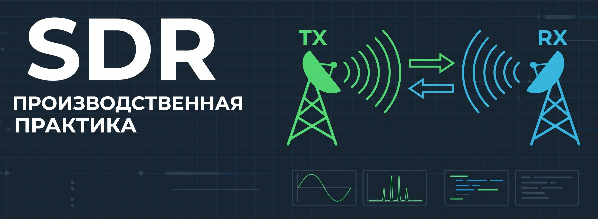

  

# Производственная практика - SDR
## Демин Сергей Алексеевич

## Практические работы
|№|Задание|Отчет|Дата сдачи|
|:-:|-|:-:|:-:|
|1|Построение радио-приёмника.|docs/report1.md|15.09.26|
|2|Прием-передача сэмплов на 2 SDR.|docs/report2.md|20.10.26|

## Занятия
|№|Дата занятия|Тема лекции|Тема практики|
|:-:|--|--|--|
|1|08.09.26|Основы структурной схемы цифровой радиосвязи.|Архитектура Adalm Pluto SDR. GNU Radio. Построение радио-приёмника|
|2|15.09.26|Основы структурной схемы цифровой радиосвязи|GNU Radio. Построение радио-приёмника, радио-передатчика.|
|3|22.09.26|Введение в архитектуру SDR-устройств| Знакомство с библиотеками Soapy SDR, Libio для работы с Adalm Pluto SDR. Инициализация SDR-устройства. Работа с буфером: получение цифровых IQ-отсчетов.|
|4|29.09.26|Введение в архитектуру SDR-устройств| Знакомство с библиотеками Soapy SDR, Libio для работы с Adalm Pluto SDR. Инициализация SDR-устройства. Работа с буфером: получение цифровых IQ-отсчетов. Продолжение.|
|5|06.10.26|Введение в архитектуру SDR-устройств|Работа с буфером: получение цифровых IQ-отсчетов. Прием-передача сэмплов на 2 SDR. Продолжение.|
|6|13.10.26|Введение в архитектуру SDR-устройств|Работа с буфером: получение цифровых IQ-отсчетов. Прием-передача сэмплов на 2 SDR. Свертка|
|7|20.10.26| - |Работа с буфером: получение цифровых IQ-отсчетов. Прием-передача сэмплов на 2 SDR.|
|8|27.10.26|Приёмник: фильтрация, синхронизация и демодуляция.|Передатчик: биты -> модуляция -> upsampling -> свертка -> TX. Начало приемника.|
|9|03.11.26| | |
|10|10.11.26| | |
|11|17.11.26| | |
|12|24.11.26| | |
|13|01.12.26| | |
|14|08.12.26| | |
|15|15.12.26| | |
|16|22.12.26| | |
|17|29.12.26| | |

<!-- | | | | | -->
