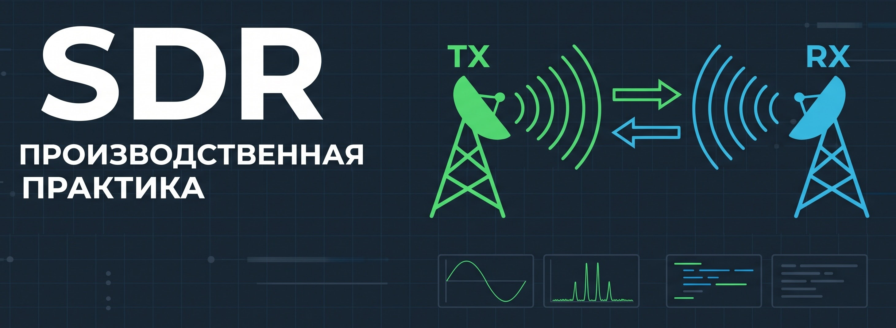

<p align="center">
  
</p>

# Производственная практика - SDR
## Демин Сергей Алексеевич

## Структура проекта

```md
"SDR"
├── docs/
│   ├── images/         # Иллюстрации, графики и спектрограммы
│   ├── report1.md      # Отчет №1
│   ├── report2.md      # Отчет №2
│   └── report3.md      # Отчет №3
├── include/
│   ├── config.h        # Частоты, SPS, фильтр h и режим модуляции
│   ├── modulate.h      # BPSK, QPSK, апсэмплинг и свертка
│   ├── sdr.h           # Инициализация PlutoSDR
│   └── tx_rx.h         # Прием и передача
├── src/
│   ├── main.cpp        # Запуск rx/tx режимов
│   ├── modulate.cpp    # Генерация бит, BPSK/QPSK и свертка
│   ├── plot.py         # Отрисовка I/Q
│   ├── sdr.cpp         # Создание устройства в SoapySDR
│   └── tx_rx.cpp       # Прием, отправка и сохранение сэмплов
├── thirdparty/         # Сторонние проекты и библиотеки
│   ├── libad9361-iio
│   ├── libiio
│   ├── imgui
│   ├── implot
│   ├── SoapyPlutoSDR
│   └── SoapySDR
├── CMakeLists.txt
├── .gitmodules
├── .gitignore
├── README.md
└── и пр.
```

## Сборка и запуск проекта

### 1. Требования и зависимости
Для работы проекта необходимы компилятор C++, CMake, Python3, а также библиотеки для взаимодействия с Adalm-Pluto (libiio, libad9361-iio, SoapySDR и драйвер SoapyPlutoSDR).

Установка основных пакетов в Ubuntu/Debian:
```bash
sudo apt update
sudo apt install -y build-essential cmake git libusb-1.0-0-dev libxml2-dev libbison-dev flex libcdk5-dev python3-numpy python3-matplotlib
```

### 2. Инициализация сабмодулей
```bash
git submodule update --init --recursive
```

### 3. Сборка зависимостей (thirdparty)
1. **libiio**:
   ```bash
   cd thirdparty/libiio
   cmake -B build -DENABLE_IPV6=OFF
   cmake --build build -j$(nproc)
   sudo cmake --install build
   sudo ldconfig
   cd ../..
   ```

2. **libad9361-iio**:
   ```bash
   cd thirdparty/libad9361-iio
   cmake -B build
   cmake --build build -j$(nproc)
   sudo cmake --install build
   sudo ldconfig
   cd ../..
   ```

3. **SoapySDR**:
   ```bash
   cd thirdparty/SoapySDR
   cmake -B build
   cmake --build build -j$(nproc)
   sudo cmake --install build
   sudo ldconfig
   cd ../..
   ```

4. **SoapyPlutoSDR**:
   ```bash
   cd thirdparty/SoapyPlutoSDR
   cmake -B build
   cmake --build build -j$(nproc)
   sudo cmake --install build
   sudo ldconfig
   cd ../..
   ```

### 4. Сборка проекта
```bash
mkdir build
cd build 
cmake ..
make
```

---

### 5. Поиск устройств и запуск
#### Определение URI подключенных устройств
Для поиска подключенных плат Adalm-Pluto выполните:
```bash
SoapySDRUtil --find
```
В выводе команды найдите URI нужных устройств.

#### Запуск программы
Синтаксис запуска:
```bash
cd build
./main <rx|tx> [uri]
```

### 6. Визуализация принятых сэмплов
Для отображения графиков I/Q компонент и амплитуды записанного сигнала:
1. Убедитесь, что файл `rxdata.pcm` находится по пути `./build/rxdata.pcm`:
2. Запустите скрипт визуализации:
   ```bash
   python3 src/plot.py
   ```

## Практические работы
|№|Задание|Отчет|Дата сдачи|
|:-:|-|:-:|:-:|
|1|Построение радио-приёмника.|docs/report1.md|15.09.26|
|2|Прием-передача сэмплов на 2 SDR.|docs/report2.md|20.10.26|
|3|Биты → BPSK/QPSK → upsampling → свёртка → TX|docs/report3.md|-|


## Занятия
|№|Дата занятия|Тема лекции|Тема практики|Что делал?|
|:-:|--|--|--|--|
|1|08.09.26|Основы структурной схемы цифровой радиосвязи.|Архитектура Adalm Pluto SDR. GNU Radio. Построение радио-приёмника|Собрал радиоприемник в GNU Radio, но он не заработал|
|2|15.09.26|Основы структурной схемы цифровой радиосвязи|GNU Radio. Построение радио-приёмника, радио-передатчика.|Ничего не менял, запустил радиоприемник и он заработал + ловил wifi сигнал|
|3|22.09.26|Введение в архитектуру SDR-устройств| Знакомство с библиотеками Soapy SDR, Libio для работы с Adalm Pluto SDR. Инициализация SDR-устройства. Работа с буфером: получение цифровых IQ-отсчетов.|Установил библиотеки + запустил код для приемо-передачи на одной SDR|
|4|29.09.26|Введение в архитектуру SDR-устройств| Знакомство с библиотеками Soapy SDR, Libio для работы с Adalm Pluto SDR. Инициализация SDR-устройства. Работа с буфером: получение цифровых IQ-отсчетов. Продолжение.|Начал разделять код на TX/RX, но пока успехом это не увенчалось|
|5|06.10.26|Введение в архитектуру SDR-устройств|Работа с буфером: получение цифровых IQ-отсчетов. Прием-передача сэмплов на 2 SDR. Продолжение.|Разделил код, но ничего не заработало :(|
|6|13.10.26|Введение в архитектуру SDR-устройств|Работа с буфером: получение цифровых IQ-отсчетов. Прием-передача сэмплов на 2 SDR. Свертка|Дописал синхронизацию по времени, вроде что-то начало передаваться|
|7|20.10.26| - |Работа с буфером: получение цифровых IQ-отсчетов. Прием-передача сэмплов на 2 SDR.|Доработал python файл вывода полученного сигнала и все заработало :)|
|8|27.10.26|Приёмник: фильтрация, синхронизация и демодуляция.|Передатчик: биты -> модуляция -> upsampling -> свертка -> TX. Начало приемника.|Начал писать светрку, пока вроде получается|
|9|03.11.26|Приёмник: фильтрация, синхронизация и демодуляция.|Приемник. Выбор символьных отсчётов и их визуализация после согласованного фильтра|Дописал свертку, все заработало, даже что-то передается|
|10|10.11.26|-|Приемник. Выбор символьных отсчётов и их визуализация после согласованного фильтра. Добавление визуального интерфейса ImGUI для визуализации данных с AdalmPluto.|Разбил на многофайловый проект и начал писать GUI + поработал над оформлением репозитория|
|11|17.11.26| | | |
|12|24.11.26| | | |
|13|01.12.26| | | |
|14|08.12.26| | | |
|15|15.12.26| | | |
|16|22.12.26| | | |
|17|29.12.26| | | |

<!-- | | | | | -->
