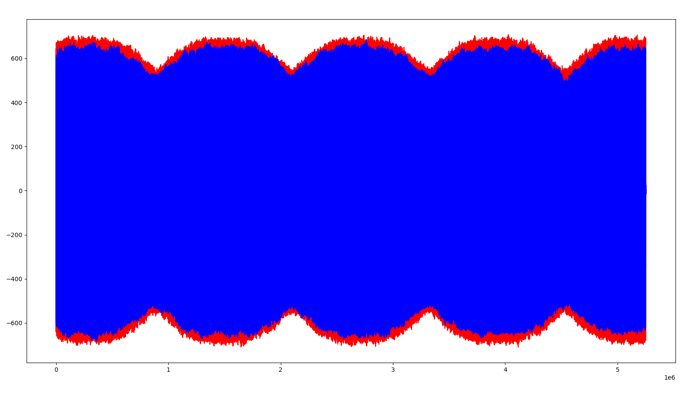
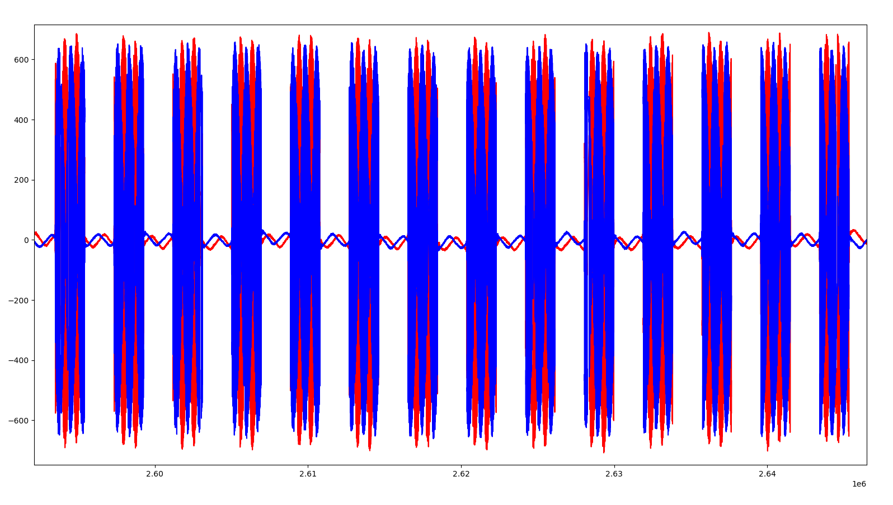
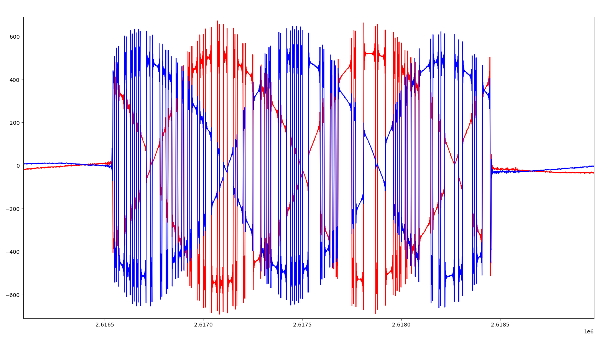
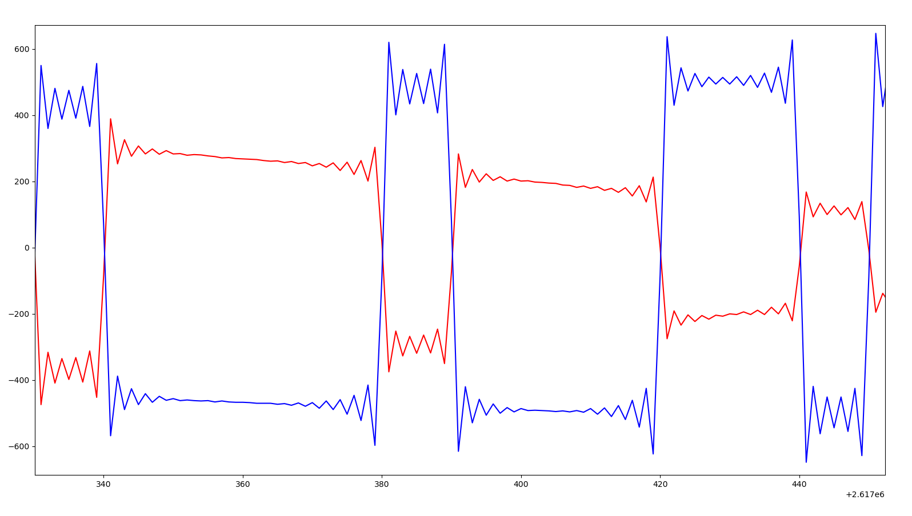

## Тема практической работы: Формирование и передача BPSK/QPSK-сигнала

### Цель работы:

1. Сформировать последовательность битов и преобразовать её в BPSK- и QPSK-символы.
2. Увеличить число отсчётов на символ и выполнить свёртку с формирующим фильтром.
3. Подготовить IQ-отсчёты для передачи через Adalm Pluto SDR и рассмотреть сохранённые графики приёма.

### Теория:

Передатчик преобразует биты в комплексные символы I + jQ. В BPSK один символ передаёт один бит: в используемом коде биту 0 соответствует I = −A, а биту 1 соответствует I = +A. Составляющая Q равна нулю. Получаются две точки на оси I с противоположными фазами.

В QPSK один символ передаёт два бита. Первый задаёт знак I, второй задаёт знак Q. При амплитуде каждой составляющей A возможны четыре сочетания:

| Биты | I | Q |
|:-:|:-:|:-:|
| 00 | −A | −A |
| 01 | −A | +A |
| 10 | +A | −A |
| 11 | +A | +A |

На один символ приходится несколько отсчётов. Сначала делаем upsampling: вставляем нули между соседними символами. При SPS = 10 за каждым символом идут девять нулевых комплексных отсчётов.

Затем пропускаем последовательность через формирующий фильтр. В этой работе все его коэффициенты равны единице: 

`h = {1, 1, 1, 1, 1, 1, 1, 1, 1, 1}`. 

Свёртку считаем отдельно для I и Q:

```text
y[n] = Σ h[k] · x[n − k],  k = 0, …, SPS − 1.
```

Отсчёты до начала входной последовательности считаются нулевыми. После вставки нулей такой фильтр растягивает каждый символ в прямоугольный импульс длиной десять отсчётов. Это простой способ получить «полочки» на передаче.

### Выполнение работы:

#### 1. Подготовка символов

Амплитуда в настройках равна 1500, на символ приходится 10 отсчётов. Параметр mode выбирает BPSK (0) или QPSK (1).

Функция gen_bits заполняет массив псевдослучайными нулями и единицами. Функции bpsk и qpsk переводят их в символы. В буфере значения чередуются, поэтому для хранения N комплексных символов нужны 2N чисел типа int16_t.

#### 2. Upsampling и свёртка

Функция `upsample` размещает символы через каждые десять комплексных отсчётов и заполняет промежутки нулями. Функция `convolve` суммирует произведения входных отсчётов на коэффициенты фильтра отдельно для двух составляющих.

Саму функцию свёртки написать получилось легко. Мы уже разбирали её на МОЦОС, поэтому формула была знакомой. Оставалось перенести её в цикл и отдельно посчитать результат для I и Q.

При частоте дискретизации 1 МГц и SPS = 10 внутри посылки получаем 100 тысяч символов в секунду. Для BPSK это 100 кбит/с, для QPSK 200 кбит/с.

#### 3. Передача и типы отсчётов

С типами данных разбирались гораздо дольше. Не сразу поняли, что в функциях, которые обрабатывают отсчёты для SDR, нужно указывать именно int16_t. В нашей программе выбран формат CS16: I и Q хранятся как знаковые 16-битные числа. Поэтому буферы и аргументы функций, через которые передаются IQ-отсчёты, должны использовать этот тип.

При этом биты до модуляции хранятся в массиве int. Внутри свёртки сумма накапливается в int32_t, а в выходной буфер записывается int16_t. Сначала было непонятно, где какой тип нужен. На это потратили больше времени, чем на сам расчёт свёртки.

В программе режим `tx` последовательно вызывает генерацию битов, модуляцию, upsampling и свёртку. Перед копированием в передающий буфер программа сдвигает значения на четыре разряда для используемого формата отсчётов. Начало буфера занимают служебные слова и временная метка.

Первое устройство принимает на 800 МГц и передаёт на 850 МГц, а у второго частоты меняются местами. Программа назначает передачу на 4 мс позже временной метки принятого блока и отправляет данные на каждой второй итерации цикла. В зависимости от режима принятые отсчёты попадают в rxdata.pcm или txdata.pcm.

#### 4. Разбор графиков

Сначала посмотрел общий график I и Q. На нём видны изменения уровня сигнала, но отдельные символы сливаются.

<p align="center">
  
</p>

Увеличил участок записи. Здесь уже можно различить посылки и паузы между ними; в паузах амплитуда заметно ниже.

<p align="center">
  
</p>

Затем приблизил одну посылку. I и Q быстро меняются, а их общий уровень меняется медленнее.

<p align="center">
  
</p>

При ещё большем увеличении видны переходы между уровнями и участки, похожие на «полочки». На границах остаются выбросы и колебания.

<p align="center">
  
</p>

На приёме I и Q отличаются от прямоугольных импульсов в передающем буфере. На форму влияют радиоканал, фильтры устройств и рассогласование передатчика с приёмником. По одним картинкам я не могу определить, что именно даёт каждое искажение. Проверить восстановление битов тоже пока нельзя: сначала нужно обработать принятый сигнал и сравнить биты с переданной последовательностью.

### Вывод:

Получилось собрать передающую цепочку: BPSK/QPSK, вставку нулей и свёртку. На сохранённых графиках видны отдельные посылки и переходы между уровнями. С функцией свёртки справился быстро, потому что уже разбирали её на МОЦОС. Долго разбирались с типами данных: не сразу поняли, что для IQ-буферов в формате CS16 и аргументов обрабатывающих их функций нужен int16_t.

До восстановления битов на приёме пока не дошли. Сигнал на графиках есть, но подтвердить, что все переданные биты приняты правильно, ещё не получилось. Дальше нужно отфильтровать сигнал, настроить синхронизацию и выбрать символьные отсчёты.